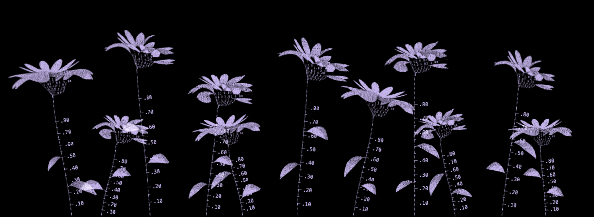

# Flower Field

A lavender dotwork flower field with gently swaying blooms, varied leaves, and numbered stem rulers.

## Inspiration

[Huichuan Wang](https://www.paintriver.art/), *Computational Arts University Showcase Promotional Artwork* (2023), [Victoria and Albert Museum](https://www.vam.ac.uk/event/D5BEGmd6O4/digital-art-showcase-2023). Accessed 12 Oct. 2026.

## Agent skills

Built with Codex using `frontend-design`; refined with [critique-flower-field](.agents/skills/critique-flower-field/SKILL.md) and verified with [verify-flower-field](.agents/skills/verify-flower-field/SKILL.md), adapted from the personal website’s critique and verification skills.

The verification method began with Cursor’s [create-verification-skill](https://github.com/cursor/plugins/tree/main/pstack/skills/create-verification-skill) and [maintain-verification-skill](https://github.com/cursor/plugins/tree/main/pstack/skills/maintain-verification-skill). The critique method developed through iterative reviews of the personal website’s flower artwork, turning feedback about stray petals, awkward angles, missing details, and unreadable rulers into a reference-based render–critique–fix–verify loop.
