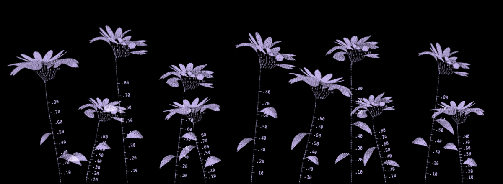

# Flower field

A procedural remaster of the lavender dotwork field. Curved petal surfaces, numeric bowls, leaves and stems are generated in code; no flower bitmap is used by the renderer.

[Download the video](docs/flower-field-growth.webm)

## Visual reference

The screenshot above is the approved visual target, not a screenshot of this implementation. This is a first study awaiting visual review.

## Run

Run `npm start`, then open http://127.0.0.1:4173. The artwork has no runtime packages or build step. Opening `index.html` directly also works.

## Interaction

- Drag or swipe right, or scroll horizontally right, to introduce and grow flowers. Reverse to rewind the same plants.
- Shift + vertical wheel also controls growth. Ordinary vertical scrolling remains page scrolling.
- Use the Growth slider or focus the artwork and use Left/Right arrows. Home empties the field; End restores full growth.
- Study controls change seed, petal count, openness, curl, length, bowl depth, view angle/tilt and wind strength/rate.
- Reset restores the initial parameters and full growth. Export saves the actual parameters and growth as JSON.

The first view is fully grown to make comparison with the approved target immediate. Stem and bowl labels represent normalized height, not physical units. Wind rate is cycles per second for the principal sway component. Wind is independent of growth; reduced motion stops automatic wind while preserving explicit growth input.

## Model

Canvas 2D projects generated petal ribbons and a tapered numeric bowl. Authored cubic centerlines define slender upright and sweeping silhouettes; length, opening, curl, width and viewpoint determine the surfaces. Continuous black petal silhouettes provide occlusion; deterministic lavender stipple provides the visible texture. The renderer caches bloom images until their geometry changes. These images are generated from geometry, not external raster artwork. The layout uses the approved screenshot’s stem heights and leans. A shared growing stem curve positions its rulers, leaves and flower head; the projected bottom of each numeric cup meets the stem tip. Plant timelines are staggered across one bounded field progress value.

## Verification

Install test dependencies with `npm install` and `npx playwright install chromium`, then run `npm test -- /private/tmp/flower-field-verification/review`. `PLAYWRIGHT_MODULE` can point to an existing Playwright installation. The harness starts an isolated loopback server and headless Chromium, exercises production input paths, retains evidence and closes its browser/server even on failure.

The original raster source and scripts/ checks are retained for historical reference; npm test runs the procedural harness below.

Project-local [create](.cursor/skills/create-verification-skill/SKILL.md), [verify](.cursor/skills/verify-flower-field/SKILL.md) and [maintain](.cursor/skills/maintain-verification-skill/SKILL.md) skills cover the workflow and feature map. Browser-emulated touch is not physical-device verification. Actual hidden-tab behavior and human acceptance of visual fidelity remain unverified.

## Inspiration

User-supplied attribution: Huichuan Wang, *Computational Arts University Showcase Promotional Artwork* (2023), Victoria and Albert Museum. [Artist portfolio](https://www.paintriver.art/). [Showcase](https://www.vam.ac.uk/event/D5BEGmd6O4/digital-art-showcase-2023).

The preserved [original reference](docs/original-reference.png) informs flower structure. This implementation does not claim to reproduce the artist's algorithm or the meaning of her numbers. The lavender dotwork field is the visual target for this remaster.
